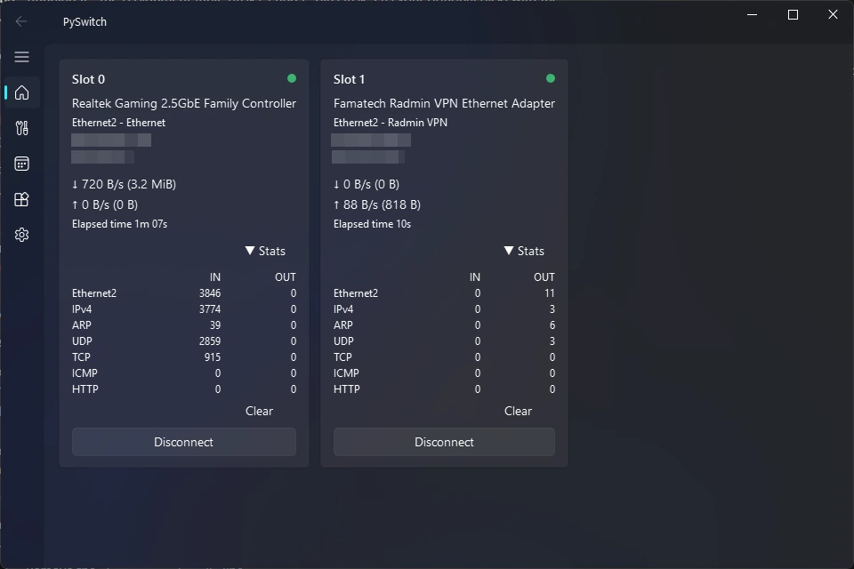
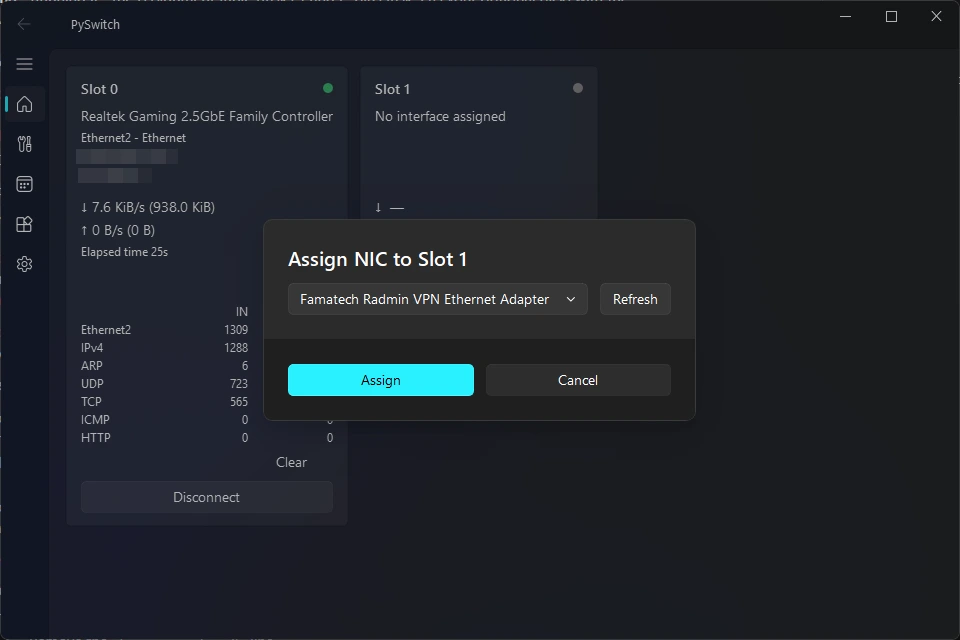
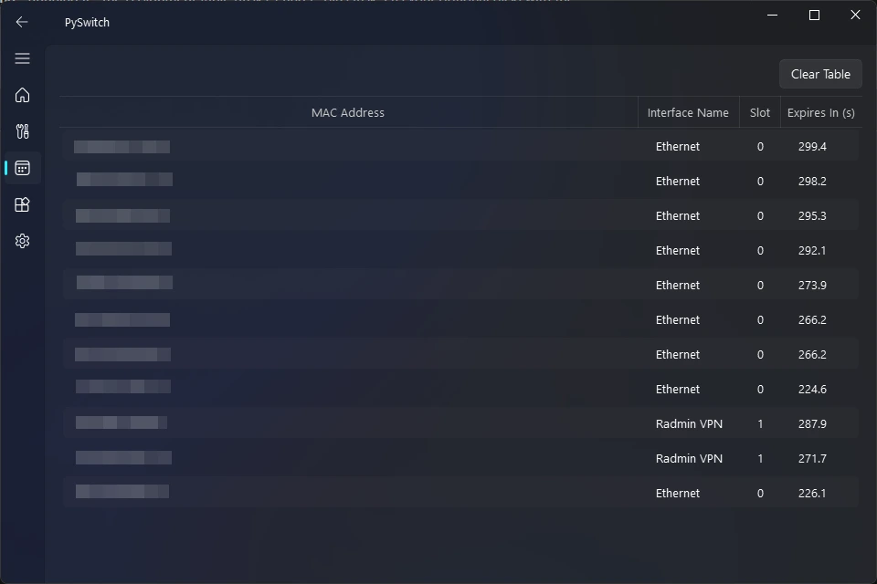
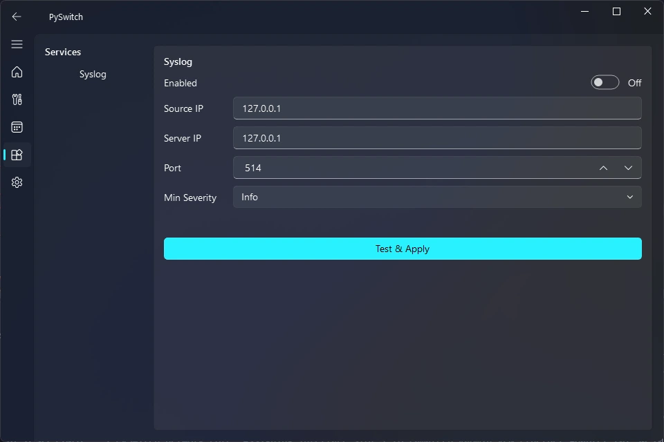
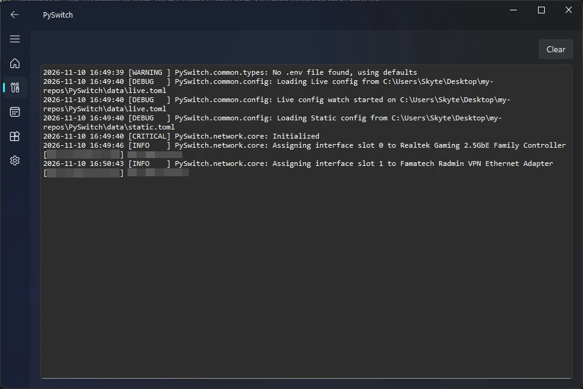
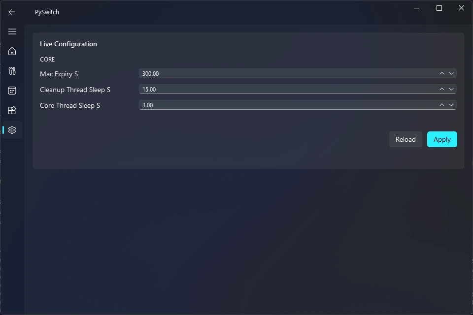
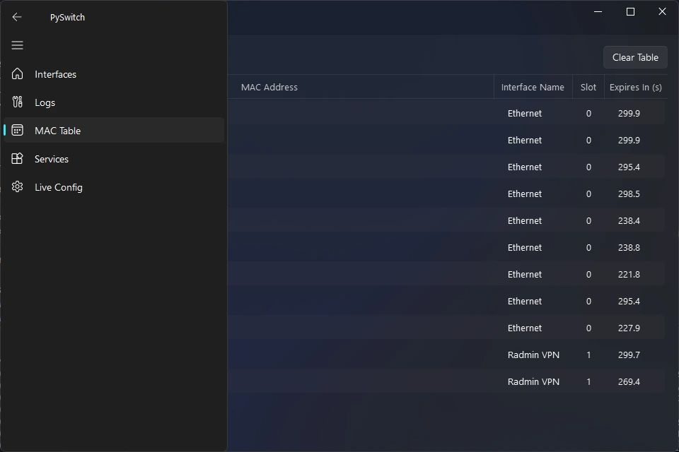
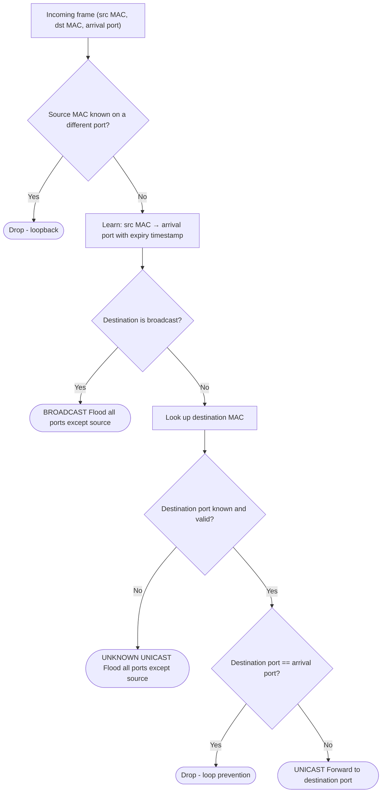

# PySwitch

[](https://www.python.org/)
[](https://doc.qt.io/qtforpython-6/)
[](https://www.microsoft.com/windows)

A two-port software L2 switch for Windows with a desktop GUI. It bridges two physical network cards, learns MAC addresses, forwards or floods frames between them, and reports per-port traffic statistics. Frames are captured and sent through Npcap's `wpcap.dll`, called directly via `ctypes`.

It's a semester project for a switching and routing course, tested against real Cisco networking hardware.



## Features

- **MAC learning and forwarding.** Source addresses are learned per port with a TTL. Unicast frames go to the learned port; broadcast and unknown unicast frames are flooded to every port except the one they came from.
- **Loop protection.** Frames whose source MAC is known on a different port, or whose destination is the port they arrived on, are dropped. Recently seen frames are deduplicated.
- **Per-port statistics.** Ingress and egress counters for each protocol found in the frame (Ethernet II, IPv4, ARP, UDP, TCP, ICMP, HTTP), total bytes and live throughput over a rolling window.
- **Cable pull detection.** Link up/down events come from WMI (`Win32_NetworkAdapter`). When a cable is pulled, that port's MAC entries are dropped right away.
- **Syslog (RFC 5424).** Log records go out as syslog messages in Ethernet II / IPv4 / UDP frames that the switch builds itself and sends through its own ports. Server, source IP, port and minimum severity can be changed at runtime; new settings only apply after a test message is sent successfully.
- **Live configuration.** Timers such as MAC expiry are read from `data/live.toml`, which is watched for changes and can also be edited from the GUI.

## Screenshots

| Assigning a NIC to a slot                        | MAC table                                      |
| ------------------------------------------------ | ---------------------------------------------- |
|  |      |
| **Syslog settings**                              | **Logs**                                       |
|          |                |
| **Live configuration**                           | **Navigation**                                 |
|       |  |

## How it works

Each port has a capture thread that batches frames into a shared queue. The switch core takes frames off the queue, drops duplicates and frames from inactive ports, records statistics and decides where to send each frame:



A background thread expires old MAC entries, and another one listens for WMI link events. Syslog hooks into Python's standard `logging` module through a custom handler, so anything logged anywhere in the app can be forwarded.

[`docs/documentation.md`](docs/documentation.md) has the full pipeline, the metrics flow and the exact syslog packet format.

## Running it

Requirements:

- Windows 10 or 11
- [Npcap](https://npcap.com/), installed with the default options, which provide `wpcap.dll`
- [uv](https://docs.astral.sh/uv/), which also fetches Python 3.14 if you don't have it
- Two network adapters to switch between

```bash
uv sync
uv run main.py
```

Assign an adapter to each slot on the **Interfaces** tab, and the switch starts forwarding between them.

On first run, the app creates a `data/` directory with `live.toml` (reloaded while running), `static.toml` (read at startup) and `pyswitch.log`. To put it somewhere else, set `config_directory` in a `.env` file.

## Assignment

The task was to build a multilayer software switch with two ports, controlling the network cards through packet drivers and tested on the course's Cisco lab hardware. Tasks 1 and 2 were required, plus one of the optional tasks 3, 4 and 5. The original assignment is in [`docs/assignment.pdf`](docs/assignment.pdf).

| Task                 | Status                         |
| -------------------- | ------------------------------ |
| 1. MAC table         | Done                           |
| 2. Statistics        | Done                           |
| 4. Syslog (optional) | Done, the chosen optional task |

The assignment called for C++ or C#. Python was approved by the lab instructor because of the GUI requirement. AI assistance was used for the GUI boilerplate and for the low-level interop glue (the `ctypes` bindings to `wpcap.dll` and the WMI link watcher). The switching logic, MAC table, statistics, frame parsing and building, and the syslog service are my own.

## Known limitations

- **Ingress stats can be attributed to the wrong port.** On Windows, `wpcap.dll` can show the same traffic on more than one interface. Deduplication hides most of it but doesn't fix the underlying race, so some ingress counts may land on the wrong slot.
- **Deduplication can drop legitimate frames.** A frame identical to one of the last few seen is treated as a duplicate, even if it was genuinely sent twice.
- **Windows only.** It depends on Npcap and WMI.
